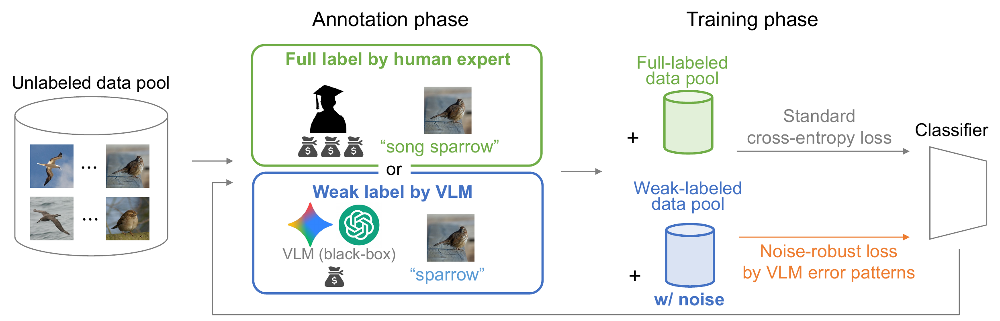

# Leveraging Vision-Language Models as Weak Annotators in Active Learning

[Phuong Ngoc Nguyen](https://arxiv.org/search/cs?searchtype=author&query=Nguyen,+P+N),
[Kaito Shiku](https://arxiv.org/search/cs?searchtype=author&query=Shiku,+K),
[Ryoma Bise](https://arxiv.org/search/cs?searchtype=author&query=Bise,+R),
[Seiichi Uchida](https://arxiv.org/search/cs?searchtype=author&query=Uchida,+S),
[Shinnosuke Matsuo](https://arxiv.org/search/cs?searchtype=author&query=Matsuo,+S)

**Accepted at IEEE ICIP 2026 (Spotlight Oral).** 



[View the overview as a PDF](image/Overview.pdf)

This repository is the official PyTorch implementation of
**"Leveraging Vision-Language Models as Weak Annotators in Active Learning."**

## Overview

Active learning reduces annotation cost by selecting informative samples under
a limited labeling budget. In this work, we study how vision-language models
(VLMs) can further reduce the need for costly human annotation in fine-grained
recognition. Although VLMs may be unreliable for fine-grained categories, they
can provide useful coarse-grained labels.

Our framework combines fine-grained human annotations with coarse-grained
VLM-generated weak labels through instance-wise supervision-level selection.
It also estimates systematic VLM label noise from a small trusted set and uses
forward correction during weak-label training. Experiments are supported on
CUB-200-2011 and FGVC-Aircraft.

## Key Features

- Coarse weak-label generation with Gemini models.
- Joint learning from human-provided fine labels and VLM-generated weak labels.
- Instance-wise selection of samples and supervision levels under a fixed budget.
- Transition-matrix estimation from trusted annotations.
- Forward correction for systematic weak-label noise.
- Support for CUB-200-2011 and FGVC-Aircraft.
- ResNet, EfficientNetV2, ViT, and ConvNeXt backbones through `timm`.

## Repository Layout

```text
src/
  run.py                    # Main experiment entry point
  arguments.py              # Command-line configuration
  query_strategy.py         # Sample and supervision-level selection
  noise_correction.py       # Transition estimation and forward correction
  train.py                  # Weak/full supervision training and evaluation
  models.py                 # Backbones and prediction heads
  utils.py                  # Reproducibility, logging, and metrics
  datasets/
    loaders.py              # Dataset splits and DataLoader construction
    cub200.py               # CUB-200-2011 utilities
    aircraft.py             # FGVC-Aircraft utilities
  vlm/
    labeler.py              # VLM label generation
```

Datasets, generated VLM labels, experiment logs, NumPy arrays, and model
checkpoints are intentionally ignored by Git.

## Setup

Install PyTorch for your CUDA environment first. For example:

```bash
pip install torch torchvision torchaudio --index-url https://download.pytorch.org/whl/cu118
pip install -r requirements.txt
```

Run all commands below from the repository root.

## Generate VLM Weak Labels

> [!IMPORTANT]
> VLM label generation requires your own Gemini API key. Keep the key outside
> the source code and never commit it to this repository.

Export your key as an environment variable in the current terminal session:

```bash
export GEMINI_API_KEY="your_key_here"
```

The labeler also accepts `GOOGLE_API_KEY` as a fallback. Passing a key through
`--api_key` is supported, but using an environment variable is recommended so
the key is not saved in shell history.

Generate weak labels for CUB-200-2011:

```bash
python -m src.vlm.labeler --dataset cub200 --label_type weak
```

This creates:

```text
result/cub_predicted_weak_labels.npy
```

Generate weak labels for FGVC-Aircraft:

```bash
python -m src.vlm.labeler --dataset aircraft --label_type weak
```

This creates:

```text
result/air_predicted_weak_labels.npy
```

Full-label VLM generation is also supported by `src.vlm.labeler`, but the
training pipeline uses predicted weak-label files by default. If a predicted
weak-label file is unavailable, the dataset loader falls back to ground-truth
weak labels.

## Training

### Full proposed setting

Train with VLM weak labels and transition-matrix correction:

```bash
python -m src.run \
  --dataset cub200 \
  --budget 150 \
  --cost_weak 0.02 \
  --model_backbone vit_b_16 \
  --lr 3e-05 \
  --seed 0 \
  --num_rounds 6 \
  --output_dir result/cub_vlm_correction/
```

### Without noise correction

Train with VLM weak labels but without the transition matrix:

```bash
python -m src.run \
  --dataset cub200 \
  --budget 150 \
  --cost_weak 0.02 \
  --model_backbone vit_b_16 \
  --lr 3e-05 \
  --seed 0 \
  --num_rounds 6 \
  --no_transition_matrix \
  --output_dir result/cub_vlm_no_correction/
```

### Ground-truth weak-label baseline

Disable VLM labels and transition-matrix correction:

```bash
python -m src.run \
  --dataset cub200 \
  --budget 150 \
  --cost_weak 0.1 \
  --model_backbone vit_b_16 \
  --lr 3e-05 \
  --seed 0 \
  --num_rounds 6 \
  --no_vlm_labels \
  --no_transition_matrix \
  --output_dir result/cub_ground_truth_weak/
```

Use `--dataset aircraft` to run the corresponding FGVC-Aircraft experiment.

## Outputs

Each output directory contains the experiment log, training histories, initial
full-label indices, and the estimated transition matrix when enabled:

```text
<output_dir>/log.txt
<output_dir>/history/round_<round>_history.npz
<output_dir>/round0_full_cub.npy
<output_dir>/transition_matrix_round0_cub.npy
<output_dir>/round0_full_air.npy
<output_dir>/transition_matrix_round0_air.npy
```

Use a separate `--output_dir` for every dataset, seed, and experimental setting.

## Citation

If you use this repository, please cite the associated paper. Citation metadata
is provided in [`CITATION.cff`](CITATION.cff).

## Acknowledgements

The instance-wise supervision-level selection strategy is adapted from the
[ISOAL](https://github.com/matsuo-shinnosuke/ISOAL) implementation of
*Instance-wise Supervision-level Optimization in Active Learning*. We thank the
authors for making their research code available.

```bibtex
@inproceedings{matsuo2025isoal,
  title = {Instance-wise Supervision-level Optimization in Active Learning},
  author = {Shinnosuke Matsuo and Riku Togashi and Ryoma Bise and Seiichi Uchida and Masahiro Nomura},
  booktitle = {Computer Vision and Pattern Recognition},
  year = {2025},
}
```
